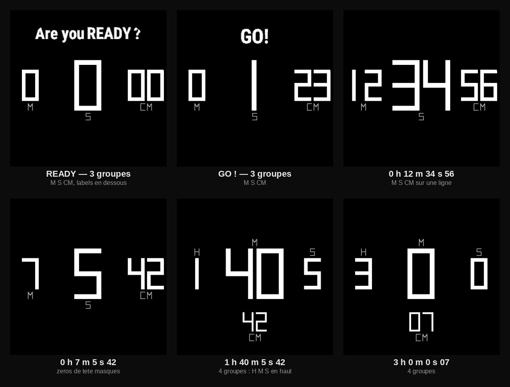
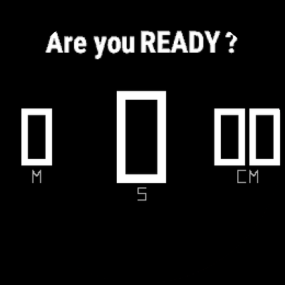
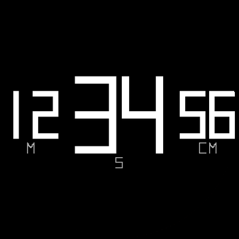
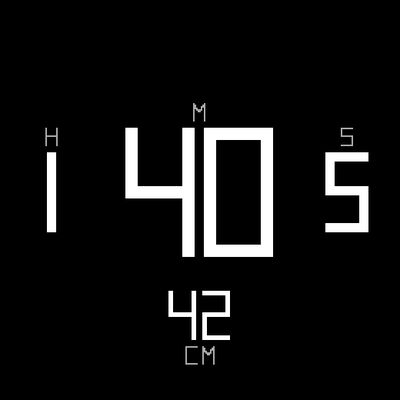

# Big Digits — Forerunner 955 Solar

Cadran Connect IQ pour **Garmin Forerunner 955 / 955 Solar**, inspiré d'un
affichage numérique à gros chiffres 7 segments.


*Aperçu : VEN 13 NOV, 01:25, 1 000 kcal, 20 000 pas, 12H.*

## Fonctionnalités

- Quatre chiffres 7 segments de **90 × 90 px**, trait de 18 px, dessinés
  directement en Monkey C (aucune police externe).
- `1` custom centré, en barre verticale, comme celui des secondes.
- Secondes horizontales en bas au centre : deux chiffres **10 × 14**, trait 2 px.
- Date : jour en **7 segments 12 × 18**, jour de la semaine et mois en police
  trait **10 × 12** (1 px), en blanc.
- Calories actives à gauche et pas à droite, en colonnes verticales de chiffres
  **7 segments 10 × 14**, en blanc, avec petits repères `C` et `P` en gris.
  Les calories actives sont estimées : Connect IQ ne fournit que le total
  journalier, le cadran soustrait les calories de repos calculées depuis le
  profil utilisateur.
- Autonomie restante à droite des secondes : nombre **7 × 11**, trait 1 px, gris,
  unité `J`/`H` en petit, en haut à droite.
- Point de connexion téléphone à gauche des secondes (visible uniquement si la
  montre est connectée).
- Quatre arcs segmentés à `r=126`.
- Mise à jour chaque minute + `onPartialUpdate` pour les secondes.

## Big Digits Chrono

Application chronomètre assortie au cadran, dans le même langage 7 segments.
Elle s'installe à côté du cadran et se lance depuis la liste des applications.



| READY | En course | Après 1 h |
| --- | --- | --- |
|  |  |  |

### Principe

- **H M S** sur une ligne, **centièmes** au centre en bas.
- Avant 1 h : `M S CM` sur la ligne, `CM` prend la place libre à droite.
- Après 1 h : `H M S` sur la ligne, `CM` en bas.
- Le groupe du milieu reste **centré** et **1,6× plus grand** que les côtés
  (proportions du nombre d'or).
- Zéros de tête masqués ; centièmes toujours sur 2 chiffres.
- `Are you READY ?` avant le départ (seul `READY` est gras), `GO!` pendant 3 s,
  puis plus aucun texte.
- Aucune fioriture : pas d'arc, pas de flèche, pas de statut.

### Commandes

| Bouton | Action |
| --- | --- |
| Haut droite — START/STOP | Lancer / pause |
| Bas droite — BACK | Remise à zéro |
| Haut gauche — LIGHT | Lap (affiche le tour 2 s) |
| Bas gauche — DOWN | Retour au cadran |
| Milieu gauche — UP | Inutilisé |

### Compilation et installation

```bash
cd chrono
./build.sh
# -> chrono/bin/bigdigits-chrono-fr955.prg
```

Copier `chrono/bin/bigdigits-chrono-fr955.prg` dans `GARMIN/Apps/`, puis
débrancher/rebrancher la montre. L'application apparaît sous **Big Digits
Chrono**.

### Technique

- Temps calculé depuis `System.getTimer()` (pas d'accumulation d'erreurs).
- Timer de 20 ms pour les centièmes, arrêté en pause pour préserver la batterie.
- Lap : flash du temps du tour pendant 2 s.
- Même moteur 7 segments que le cadran (primitives graphiques, aucune police).

## Compilation

Prérequis :

- Connect IQ SDK **9.3.0** (ou compatible avec l'API 5.2) ;
- device `fr955` installé ;
- Java 21 ;
- clé de développeur **RSA 4096** au format DER.

`build.sh` lit le chemin du SDK dans `~/.Garmin/ConnectIQ/current-sdk.cfg` et
attend la clé `developer_key.der` à la racine du projet.

```bash
./build.sh
# -> bin/bigdigits-fr955.prg
```

Les clés de signature (`*.der`, `*.pem`), les sauvegardes et le dossier `bin/`
ne sont **pas versionnés** (voir `.gitignore`). Placez votre propre
`developer_key.der` à la racine avant de compiler.

## Installation

1. Brancher la montre en mode MTP.
2. Copier `bin/bigdigits-fr955.prg` dans `GARMIN/Apps/`.
3. Débrancher/rebrancher la montre pour déclencher le scan.
4. Sélectionner « Big Digits » comme cadran.

## Structure

```text
source/              Sources Monkey C du cadran
  BigDigitsApp.mc
  BigDigitsView.mc
resources/            Icône et chaînes
manifest.xml          Manifest Connect IQ du cadran
monkey.jungle         Configuration de build
build.sh              Script de compilation du cadran
result-watch.png      Aperçu du cadran
chrono/               Application chronomètre
  source/
    ChronoApp.mc
    ChronoDelegate.mc
    ChronoView.mc
  resources/          Icône et chaînes
  manifest.xml        Manifest Connect IQ du chrono
  monkey.jungle       Configuration de build
  build.sh            Script de compilation du chrono
chrono-preview.png    Aperçu des états du chrono
chrono-ready.png      Chrono — READY
chrono-running.png    Chrono — en course
chrono-hours.png      Chrono — après 1 h
```

## Compatibilité

- Forerunner 955 / 955 Solar
- Écran rond 260 × 260, MIP 64 couleurs
- `minSdkVersion` : 5.2.0
- Format 12 h / 24 h selon le réglage de la montre
- Libellés de date en français

## Remarques

- L'app ID Connect IQ et le nom de l'application sont définis dans
  `manifest.xml`.
- Le cadran ne dépend d'aucune ressource de police externe : les chiffres,
  les lettres de la date et les unités sont dessinés en primitives graphiques.
- `ActivityMonitor.Info.calories` donne les calories totales de la journée, pas
  les calories actives. Le cadran estime les calories de repos à partir de
  l'âge, la taille, le poids et le sexe du profil (`UserProfile`), puis les
  soustrait du total. Le résultat peut différer de quelques kcal de Garmin
  Connect.
- L'application déclare la permission `UserProfile` dans `manifest.xml`.
