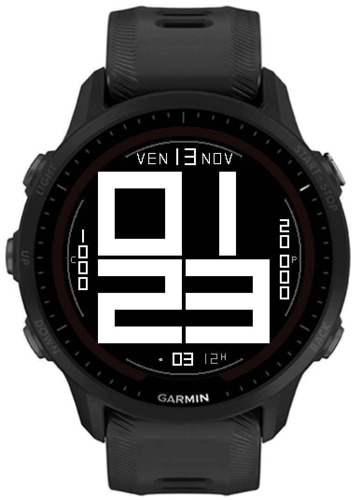

# Big Digits — Forerunner 955 Solar

Cadran rond 260×260 pour Forerunner 955 Solar, inspiré de la photo « 18:44 » :
quatre grands chiffres 7 segments dessinés sans police, avec les secondes en
bas au centre, la date en trait fin blanc (jour en 7 segments), les calories verticales à
gauche et les pas verticaux à droite.



*Rendu sur Forerunner 955 Solar — VEN 13 NOV, 01:25, 1 000 kcal, 20 000 pas, 12H.*

- Bloc de 4 cellules 90×90 (gouttière 4 px, 184 px au total), trait 18 px.
- `1` = barre verticale de 18 px centrée, comme le `1` des secondes.
- Date (lettres) en police trait 10×12 ; data en 7 segments ; jour en 7 segments ; secondes en bas.
- Ligne du bas : point de connexion téléphone, secondes, autonomie restante.
- Mise à jour chaque minute + `onPartialUpdate` pour les secondes.

## Aperçus

- `preview-B5.png` : aperçu de la géométrie (date trait fin + jour 7 segments, secondes en bas, data latérale).
- `preview-B5-sim.png` : simulation 20 000 pas / 1 000 kcal / 12H.
- `preview-B4.png` : `1` en barre, rail des secondes, batterie 5J.
- `preview-B3.png` : `1` serif.
- `preview-A.png`, `preview-B.png`, `preview-B2.png` : étapes antérieures.
- `digits-0-9.png` : planche de contrôle des dix chiffres.

## Direction B5 (actuelle)

- Bloc 184 px : 4 chiffres 90×90, gouttière 4 px, aucun rognage (coins à r=130,1).
- Secondes en bas au centre : deux chiffres 10×14, trait 2 px, blanc sur noir,
  à la même hauteur et à la même graisse que la date pixel.
- À gauche des secondes : un petit cercle plein gris (r=2) si la montre est
  connectée au téléphone (`phoneConnected`), sinon rien.
- À droite des secondes : autonomie restante en gris. Le nombre (`5`, `12`) est
  en 7 segments 7×11, trait 1 px (plus fin), même famille que les pas ; l'unité
  `J`/`H` reste en 5×7 échelle 1, à 4 px du nombre, en haut à droite.
  `CHG` est affiché petit. Départ à x=150.
- Les deux espaces autour des secondes sont de 10 px : point → secondes et
  secondes → nombre.
- Date : jour en 7 segments 12×18 à `y=13` ; lettres (jour de la semaine, mois)
  en police trait 10×12 (1 px), blanc, à `y=18`.
- Calories verticales à gauche (x=22), pas à droite (x=238) : chiffres 7 segments
  10×14, trait 2 px, blanc, interligne 17 px. Les 4 px supplémentaires
  entre milliers et centaines ne s'appliquent que si le groupe des milliers a
  deux chiffres (ex. `20 000`) ; sinon interligne de base (`1 000`, `8 214`).
  Même style que les secondes.
- Petit `C` à gauche des calories (`x=9`) et petit `P` à droite des pas
  (`x=246`), en 5×7 échelle 1, gris, au milieu des colonnes. Ils sont centrés
  entre l'arc et la colonne, avec le même espace de chaque côté.
- Pas de jauge ni de logo batterie ; l'autonomie est le texte à droite des secondes.
- Arcs segmentés 2 px à r=126 (60°, trous de 30° aux diagonales), sans ticks.
- `1` : barre verticale de 18 px centrée (x=36→54), sans drapeau ni pied.
- Aperçu : `preview-B5.png`.

## Direction B4 (précédente)

- Bloc 184 px : 4 chiffres 90×90, gouttière 4 px, aucun rognage (coins à r=130,1).
- Secondes en rail vertical 24×40 à 3 h (droite) : deux chiffres 16×16, trait 3 px,
  blanc sur noir ; le `1` du rail est une barre centrée.
- Date « LUN 2 NOV » en haut, FONT_XTINY (~11 px), sans année.
- Batterie à 9 h (gauche) : `5` en FONT_XTINY, unité `J`/`H` en micro-glyphe 6×7
  juste dessous, sans jauge ni logo ; accent vert (0x00C000).
- Pas/calories en bas, valeurs FONT_XTINY (~11 px), icônes 12 px, groupe centré à 130.
- Arcs segmentés 2 px à r=126 (60°, trous de 30° aux diagonales), sans ticks.
- `1` : barre verticale de 18 px centrée (x=36→54), sans drapeau ni pied,
  reprise à l'échelle du `1` du rail des secondes.
- Aperçu : `preview-B4.png`.

## Direction A (précédente)

- Badge secondes 56 × 18 à x=52, y=106 ; chiffres 16×17, trait 3 px, centrés.
- Cellule haut-gauche 76 px + badge 18 = 94 : grille alignée, plus de débordement.
- Date « LUN 2 NOV » sans année, 10 px au-dessus des chiffres ; anneau et ticks supprimés.
- Data en FONT_TINY 14 px, icônes 12 px, groupe centré à 130 ; valeur batterie + jauge à 3 h.
- Un seul accent (batterie) ; date #AAA, data #909090.
- Aperçu : `preview-A.png`.

## Cadran final

- Grands chiffres réduits à 94 × 94 px (haut-gauche : 78 px pour le badge).
- Date en haut (« Lun 2 Nov 2026 »).
- Autonomie restante à droite (`batteryInDays`, jours + heures).
- Pas et calories actives dans l’arc bas.
- Secondes dans le badge blanc, chiffres noirs gras 3 px.
- Aperçu du rendu réel : `preview-data.png`.

## Étude d’intégration des data

`design-study.html` : étude interactive (secondes live) avec quatre compositions,
le plan coté et les zones de data.
`design-study.png` : capture de l’étude.

## Compilation

```bash
./build.sh
# -> bin/bigdigits-fr955.prg
```

Le SDK Connect IQ 9.3.0 et le device `fr955` sont installés. La clé
`developer_key.der` est une clé RSA 4096 bits (obligatoire pour la signature
acceptée par le firmware récent).

Les clés de signature (`*.der`, `*.pem`) et le dossier `bin/` ne sont **pas
versionnés** (voir `.gitignore`). Placez votre propre `developer_key.der` à la
racine avant de compiler.

## Installation

1. Brancher la montre en mode MTP.
2. Copier `bin/bigdigits-fr955.prg` dans `GARMIN/Apps`.
3. Débrancher/rebrancher pour déclencher le scan, puis choisir « Big Digits ».
