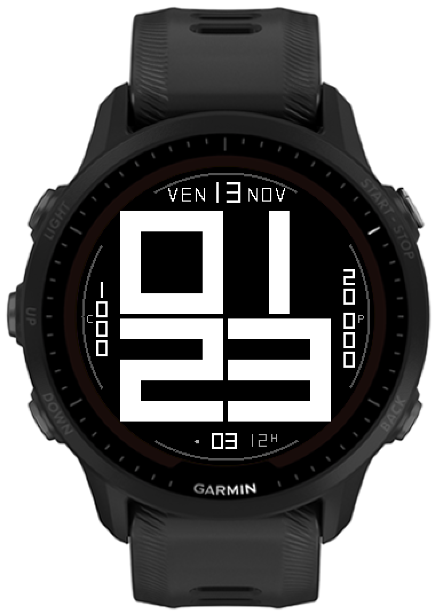
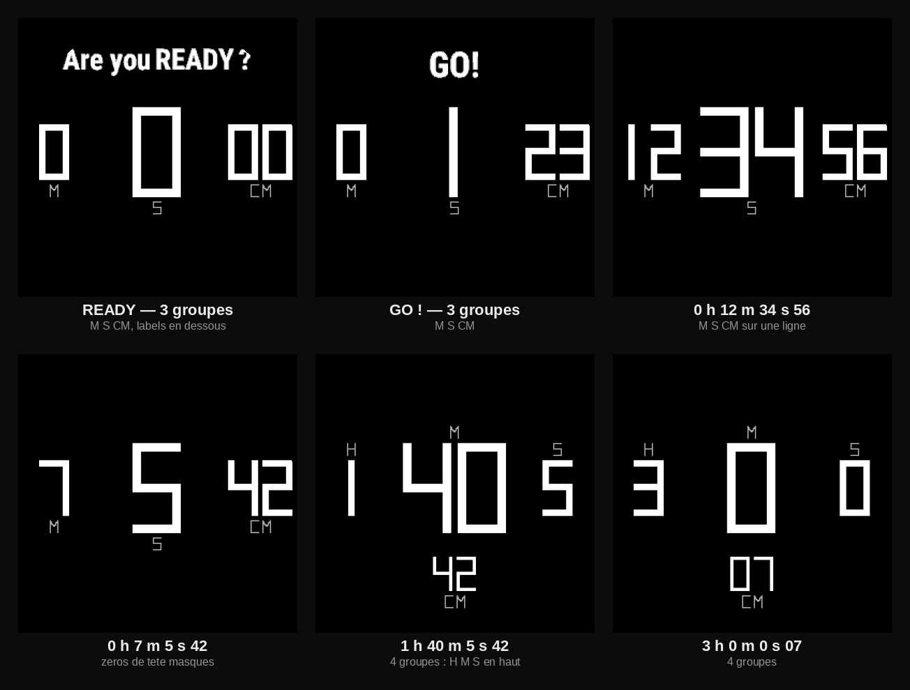
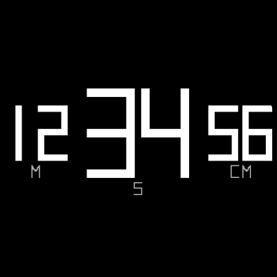

# Big Digits — Forerunner 955 Solar

Cadran Connect IQ pour **Garmin Forerunner 955 / 955 Solar**, inspiré d'un
affichage numérique à gros chiffres 7 segments.



*Aperçu : VEN 13 NOV, 01:25, 1 000 kcal, 20 000 pas, 12H.*

## Fonctionnalités

- Quatre chiffres 7 segments de **90 × 90 px**, trait de 18 px, dessinés
  directement en Monkey C (aucune police externe).
- `1` custom centré, en barre verticale, comme celui des secondes.
- Secondes horizontales en bas au centre : deux chiffres **10 × 14**, trait 2 px.
- Date : jour en **7 segments 12 × 18**, jour de la semaine et mois en police
  trait **10 × 12** (1 px), en blanc.
- Calories actives à gauche et pas à droite, en colonnes verticales de chiffres
  **7 segments 10 × 14**, en blanc, avec petits repères `C` et `P` en gris.
  Les calories actives sont estimées : Connect IQ ne fournit que le total
  journalier, le cadran soustrait les calories de repos calculées depuis le
  profil utilisateur.
- Autonomie restante à droite des secondes : nombre **7 × 11**, trait 1 px, gris,
  unité `J`/`H` en petit, en haut à droite.
- Point de connexion téléphone à gauche des secondes (visible uniquement si la
  montre est connectée).
- Quatre arcs segmentés à `r=126`.
- Mise à jour chaque minute + `onPartialUpdate` pour les secondes.

## Big Digits Chrono

Application chronomètre assortie au cadran, dans le même langage 7 segments.
Elle s'installe à côté du cadran et se lance depuis la liste des applications.



| READY | En course | Après 1 h |
| --- | --- | --- |
|  |  |  |

### Principe

- **H M S** sur une ligne, **centièmes** au centre en bas.
- Avant 1 h : `M S CM` sur la ligne, `CM` prend la place libre à droite.
- Après 1 h : `H M S` sur la ligne, `CM` en bas.
- Le groupe du milieu reste **centré** et **1,6× plus grand** que les côtés
  (proportions du nombre d'or).
- Zéros de tête masqués ; centièmes toujours sur 2 chiffres.
- `Are you READY ?` avant le départ (seul `READY` est gras), `GO!` pendant 3 s,
  puis plus aucun texte.
- Aucune fioriture : pas d'arc, pas de flèche, pas de statut.

### Commandes

| Bouton | Action |
| --- | --- |
| Haut droite — START/STOP | Lancer / pause |
| Bas droite — BACK | Remise à zéro |
| Haut gauche — LIGHT | Lap (affiche le tour 2 s) |
| Bas gauche — DOWN | Retour au cadran |
| Milieu gauche — UP | Inutilisé |

### Compilation et installation

```bash
cd chrono
./build.sh
# -> chrono/bin/bigdigits-chrono-fr955.prg
```

Copier `chrono/bin/bigdigits-chrono-fr955.prg` dans `GARMIN/Apps/`, puis
débrancher/rebrancher la montre. L'application apparaît sous **Big Digits
Chrono**.

### Technique

- Temps calculé depuis `System.getTimer()` (pas d'accumulation d'erreurs).
- Timer de 20 ms pour les centièmes, arrêté en pause pour préserver la batterie.
- Lap : flash du temps du tour pendant 2 s.
- Même moteur 7 segments que le cadran (primitives graphiques, aucune police).

## Rappels Protocoles (branche `protocol-popups`)

Huit rappels sont dessinés **directement dans le cadran** sous forme d'un
rectangle blanc avec titre, message et barre d'habitude sur 7 points. Le
contenu vient de la base RAG Synthetix (EPUB *Protocols* de Huberman) et est
intégré aux chaînes compilées : une watch face ne peut ni recevoir de texte par
`Communications`, ni appeler `WatchUi.pushView`. Les données Garmin servent de
déclencheur.

| Heure | Rappel | Déclencheur |
|---|---|---|
| 07:00 | Réveil — 10-30 min de lumière au réveil | réveil configuré |
| 12:30 | Repas — Marche 5-10 min après le repas | créneau fixe |
| 15:00 | Stimulants — Plus de caféine ni d'alcool ce soir | coucher − 8 h |
| 17:30 | Soleil — Va voir le coucher de soleil | position solaire NOAA |
| 18:30 | Pas — Marche 5 min, pas assez | pas < 85 % du stepGoal |
| 21:00 | NSDR — 20 min de repos si stress élevé | stress > 50 |
| 22:00 | Écrans — Écrans off 1 h avant le coucher | coucher − 1 h |
| 22:30 | Calme — 1-3 soupirs physiologiques | stress > 40 |

Chaque rappel dure 25 s. Aucun buzz : `Toybox.Attention` est interdit dans une
watch face (vérifié avec le binaire de debug). L'accusé de réception est visuel.
Les passages sources sont archivés dans `docs/rag-messages.md`.

Limites : textes figés à la compilation, pas de `pushView` depuis une watch
face, pas de personnalisation des heures sans recompiler. Les 12 captures
(8 messages + 4 variantes) sont indexées dans `docs/screens/README.md`.

### Méthode de capture

Les captures sont prises sur le device `fr955` avec un cadran de test temporaire
forçant le créneau : le champ « Time Simulation » du simulateur n'entre pas
17:30 de façon fiable. Le cadran de test appelle `setPopup()` avec les vraies
chaînes compilées ; le binaire livré reste compilé depuis le code non modifié.

Trois défauts observés puis corrigés au fil des captures : un crop montrait le
gizmo Blender au lieu du cadran ; le texte débordait du rectangle sur les
messages longs ; enfin `wrapText()` démarrait avec une entrée vide, ce qui
masquait la première ligne et tronquait le message. Le wrap est à 18 caractères
et les messages sont dimensionnés pour deux lignes. Voir `docs/screens/`.

Pour lancer le simulateur sur Arch : le binaire 9.3.0 demande les SONAME legacy
`libwebkit2gtk-4.0.so.37`, `libjavascriptcoregtk-4.0.so.18`, `libsoup-2.4.so.1`
(absents d'Arch qui fournit 4.1/3.0). Un répertoire de compatibilité avec des
symlinks isolés via `LD_LIBRARY_PATH` suffit. Charger l'app avec
`monkeydo <prg> fr955` (l'argument .prg de `simulator` seul ne la charge pas).

## Design v2 (2026-11-24)

Règles appliquées : `~/.config/opencode/design/UNIVERSAL_DESIGN_RULES.md` v1.8.0.
Mesures et arbitrages : `docs/messages-v2.md`, `docs/rag-messages.md`,
`docs/design-measures.md` (hors dépôt, `~/.opencode-poc/`).

- **Casse** : titre en Title Case, message en phrase (U01/U18). Accents `é è °`
  confirmés sur `fr955` (`accent-test.png`).
- **Hiérarchie** (U03/U33) : titre `FONT_SMALL`, message `FONT_XTINY`, contexte
  affiché seulement si le message tient sur une ligne. Échelle fermée à 2 niveaux.
- **Rectangle** (U79) : 232×96 à y=88, **fond noir et texte blanc**. Bordure
  pleine de 3 px colorée par catégorie (U19/U41) : orange = lumière,
  bleu = marche/pas, violet = stimulants/soleil/NSDR/écrans/calme. Le titre
  texte reste porteur du sens si la couleur n'est pas rendue.
- **Centrage** : titre, deux lignes de message et barre d'habitude sont centrés
  horizontalement (`TEXT_JUSTIFY_CENTER`) et verticalement
  (`TEXT_JUSTIFY_VCENTER`). Interligne porté à 23 px CIQ.
- **Habitude (forme)** : 7 carrés de 10 px, vides (contour blanc) si non fait,
  pleins de la couleur de bordure si fait. Exemple `docs/screens/habit-partiel-popup.png`.
- **Durée** (U62) : 25 s, vérifiée dans `onPartialUpdate`.
- **Wrap** (U73) : `wrapText()` démarre avec un tableau vide. Une entrée `""`
  initiale masquait la première ligne et tronquait tous les messages ; la
  découpe est à 18 caractères (~135 px CIQ en `FONT_XTINY` pour 216 px utiles)
  et le titre est espacé du message (6 px CIQ au lieu de 2). Défauts corrigés
  après relecture des captures.
- **Habitude** : barre de 7 carrés, fenêtre glissante 7 jours, un seul appui par
  jour via `WatchFaceDelegate` (bouton haut droit). Score persisté dans
  `Application.Storage`. Un second appui est ignoré.
- **Checks réels** : pas < 85 % du `stepGoal`, stress > 50, position solaire NOAA
  en cache (5 lectures/jour max, recalcul si déplacement > 5 km), réveil et
  coucher dérivés du profil, caféine/alcool à coucher−8 h, écrans à coucher−1 h.
- **NSDR** : 4 moments du livre (`Matin`, `Après-midi`, `Avant séance`, `Soir`)
  choisis par les données accessibles à la face. Aucune prétention à mesurer la
  dette de sommeil : les champs qualité/durée mesurées ne sont pas exposés par
  Connect IQ 9.3.0 à une watch face (`notMeasured`).

**Limite structurelle confirmée par le binaire de debug** : `Toybox.Attention`
est interdit dans une watch face — aucun buzz n'est possible depuis le cadran.
L'accusé de réception est donc visuel (barre de points) et non haptique. Le
simulateur ne permet pas de vérifier l'appui physique sur la montre : `notMeasured`.

Preuves visuelles : `docs/screens/` (12 captures relues, 8 messages + 4
variantes). `docs/popup-design-v2.png` est conservée comme témoin de l'ancien
découpage tronqué, avant correction de `wrapText`.

## Compilation

Prérequis :

- Connect IQ SDK **9.3.0** (ou compatible avec l'API 5.2) ;
- device `fr955` installé ;
- Java 21 ;
- clé de développeur **RSA 4096** au format DER.

`build.sh` lit le chemin du SDK dans `~/.Garmin/ConnectIQ/current-sdk.cfg` et
attend la clé `developer_key.der` à la racine du projet.

```bash
./build.sh
# -> bin/bigdigits-fr955.prg
```

Les clés de signature (`*.der`, `*.pem`), les sauvegardes et le dossier `bin/`
ne sont **pas versionnés** (voir `.gitignore`). Placez votre propre
`developer_key.der` à la racine avant de compiler.

## Installation

1. Brancher la montre en mode MTP.
2. Copier `bin/bigdigits-fr955.prg` dans `GARMIN/Apps/`.
3. Débrancher/rebrancher la montre pour déclencher le scan.
4. Sélectionner « Big Digits » comme cadran.

## Structure

```text
source/              Sources Monkey C du cadran
  BigDigitsApp.mc
  BigDigitsView.mc
resources/            Icône et chaînes
manifest.xml          Manifest Connect IQ du cadran
monkey.jungle         Configuration de build
build.sh              Script de compilation du cadran
result-watch.png      Aperçu du cadran
chrono/               Application chronomètre
  source/
    ChronoApp.mc
    ChronoDelegate.mc
    ChronoView.mc
  resources/          Icône et chaînes
  manifest.xml        Manifest Connect IQ du chrono
  monkey.jungle       Configuration de build
  build.sh            Script de compilation du chrono
chrono-preview.png    Aperçu des états du chrono
chrono-ready.png      Chrono — READY
chrono-running.png    Chrono — en course
chrono-hours.png      Chrono — après 1 h
```

## Compatibilité

- Forerunner 955 / 955 Solar
- Écran rond 260 × 260, MIP 64 couleurs
- `minSdkVersion` : 5.2.0
- Format 12 h / 24 h selon le réglage de la montre
- Libellés de date en français

## Remarques

- L'app ID Connect IQ et le nom de l'application sont définis dans
  `manifest.xml`.
- Le cadran ne dépend d'aucune ressource de police externe : les chiffres,
  les lettres de la date et les unités sont dessinés en primitives graphiques.
- `ActivityMonitor.Info.calories` donne les calories totales de la journée, pas
  les calories actives. Le cadran estime les calories de repos à partir de
  l'âge, la taille, le poids et le sexe du profil (`UserProfile`), puis les
  soustrait du total. Le résultat peut différer de quelques kcal de Garmin
  Connect.
- L'application déclare la permission `UserProfile` dans `manifest.xml`.
