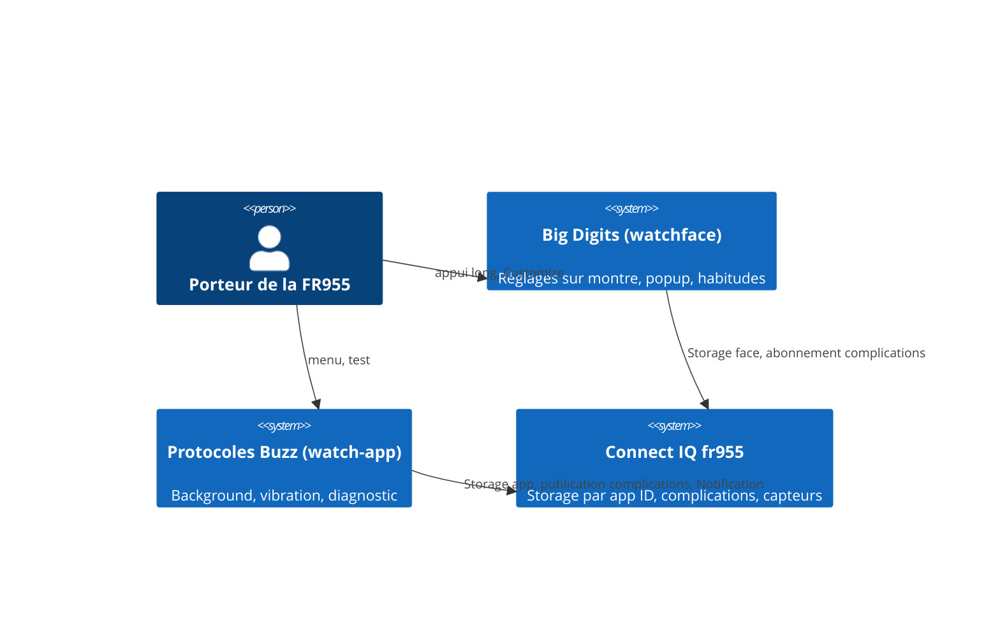

# Architecture cible — big-digits-face

> Généré le 2026-11-25 par `architecture-forge`. Toute affirmation sans preuve est marquée `hypothèse` ou `notMeasured`.

## 1. Contexte et contraintes

Cadran Connect IQ Monkey C pour **Forerunner 955 Solar** (MIP 260×260, SDK 9.3.0, API 5.2). Trois artefacts existants : face `e9cdc5a8…` (`manifest.xml:3-9`), watch-app compagnon `f72c8dae…` (`companion/manifest.xml:3-9`), chrono watch-app `8f2c1d4a…` (`chrono/manifest.xml:2-8`). Objectif : **contrôle total depuis la montre**, 100 % local, sans cloud, interface française (`manifest.xml:18-21`), installation MTP sans store (`README.md:240-245`). Benchmark associé : `docs/veille/2026-11-25-controle-total-garmin-open-source.md`.

Budgets `fr955` vérifiés dans `doc/docs/Device_Reference/fr955.html` : face **131 072 B**, watch-app/widget **786 432 B**, background/glance **65 536 B**. Interdits vérifiés : `Attention` en face (`README.md:102,166-167`), `pushView` depuis face (`README.md:88-89`), appui court et tactile sur face (`README.md:203-206`), `Duration < 5 min` (`doc/Toybox/Background.html:1707`), `getSettingsView` hors face/data field (`doc/Toybox/Application/AppBase.html:1647`).

Drivers classés : **P0** contrôle depuis la montre ; **P0** 100 % local / zéro cloud ; **P0** conformité SDK et budgets ; **P1** français et lisibilité MIP ; **P1** intégrité des habitudes ; **P2** traçabilité/CI.

## 2. Drivers de qualité

| Driver | Priorité | Mesure associée |
|---|---:|---|
| Contrôle depuis la montre | P0 | présence de `getSettingsView` sur la face + items `Menu2`, 0 réglage phone-only |
| 100 % local / zéro cloud | P0 | 0 permission réseau dans les 3 manifests, 0 appel réseau dans le code |
| Conformité SDK / budgets | P0 | `-l 3` à 0 erreur, planning ≥ 5 min, `.prg` sous budget |
| Intégrité des habitudes | P1 | test 7 j avec un jour manqué, 0 perte |
| Français / lisibilité MIP | P1 | libellés `fre`, contraste calculé ≥ 4,5:1, 0 pixel de texte dans la bordure |
| Traçabilité / CI | P2 | tag + SHA-256 + `.prev`, gates G0–G5 verts |

## 3. État des lieux

Mesures du 2026-11-25 : 1 829 lignes Monkey C (face 871, app 581, chrono 347). Binaires : face 20 972 B, compagnon 14 588 B, chrono 10 108 B — tous sous budget. Commit HEAD `62810e15c2…` du 2026-11-24, **0 tag**, 0 SHA-256 publié, 3 sources modifiées non commitées au moment de l'audit. `monkeyc` 9.3.0 présent, `-w` warnings-only (`build.sh:28`), aucun `project.typecheck` (`monkey.jungle:1-7`), **0 test unitaire versionné**, 0 CI. `tools.arch.profile` ne détecte ni langage ni persistance (outils JS/SQL aveugles au Monkey C) : ces champs sont `notMeasured`, pas une preuve d'absence. Voir `CURRENT-STATE.md`.

## 4. Options comparées

| Axe | Option A | Option B | Critère | Retenu |
|---|---|---|---|---|
| Réglages | `getSettingsView`/`Menu2` face | app/phone puis sync | contrôle montre, Storage étanche | A |
| Interaction | `onPress` priorisé (accuse → complication → indice) | accuse inconditionnel / ouverture Customize | faisabilité face | A |
| Données | write-through + log append-only | reset sur jour manqué | intégrité | A |
| Date | date civile locale + `schemaVersion` | epoch-day UTC | cohérence | A |
| Bridge | complications typées id0/id1 après spike | bridge immédiat non typé | preuve | A différé P1 |
| Planning | `Moment` borné ≥ 5 min | `max(wait,5)` | exactitude créneau | A |
| Widget | glance + `System.exitTo` en P2 | widget immédiat | besoin mesuré | A différé |

Détail des coûts, risques, réversibilités et options rejetées : `DECISIONS/ADR-0001…0008.md`. Les arbitrages ajoutés le 2026-11-25 sur les seuils et l'agrégation sont dans `DECISIONS/ADR-0009…0010.md` ; les critères sourcés du livre sont dans `protocol-criteria-from-book.md`.

## 5. Architecture cible

### Arborescence cible

```text
source/              # face : rendu, getSettingsView, onPress priorisé
  BigDigitsApp.mc    # getSettingsView() (watch face uniquement)
  BigDigitsView.mc   # popup, markDone, DataManager injecté
  BigDigitsDelegate.mc
shared/              # NOUVEAU barrel compilé dans chaque cible
  Keys.mc            # clés append-only + schemaVersion=1 (jamais renumérotées)
  Theme.mc           # palette indexée partagée config↔rendu
  Habits.mc          # log append-only, dérive des 7 bits
  DataManager.mc     # TTL par type, profile injecté, 1 lecture capteur/cycle
  Weekday.mc         # unique weekdayLetters() + fixture de test
companion/source/    # watch-app : Menu2 propre, Background Moment, Notification
chrono/source/       # inchangé, hors périmètre d'arbitrage
docs/architecture/   # ADR, roadmap, risques, scorecard
bin/                 # .prg + .prev + SHA-256 (non versionnés)
```

### Vues C4 (Mermaid)



### Invariants

- 0 permission réseau ; 0 `Attention` en watch face.
- Tout planning `Background` ≥ 300 s ; aucun `Duration(10)`.
- Toute écriture d'habitude est append-only et datée en date civile locale.
- `schemaVersion` incrémenté sans renumérotation de clés ni d'ids de complication.
- Face = source de vérité des bits jusqu'au test de parité du bridge.
- 0 ADR sans alternative rejetée ; 0 phase sans rollback.

## 6. Contrats

### API / SDK

Aucune route HTTP. Contrat de complication : id `0` = état (String courte), id `1` = prochain créneau (Number minutes), ids stables 0–255, ≤ 4 publications, `access="private"`, abonnement face uniquement, `ComplicationNotFoundException` intercepté. Erreur = absence de complication → valeurs locales de la face, jamais de champ vide. `updateComplication()` reçoit un payload complet (`:value`, `:shortLabel`, `:unit`) ; le typedef SDKprime sur l'exemple `:units` du guide. Version = `schemaVersion` dans la charge utile.

### Données

Agrégat `habit` propriétaire = face ; clé `habit.event.<date locale>` append-only ; bits 7 j dérivés ; `habit.app.day` supprimé ou aligné ; budget conservatif 8 Ko/clé, 128 Ko total. Lecture double pendant la migration, bascule derrière `schemaVersion`.

### Interface

Face = 8 rappels + popup + réglages `Customize` ; app = diagnostic 15 métriques + test ; widget = P2 conditionnel. Géométrie actuelle popup 220×138 en (20,61) (`source/BigDigitsView.mc:62-65`) à remplacer par fractions + `getFontHeight()` mesuré. ≤ 7 items par `Menu2` (règle UX, pas limite SDK).

## 7. Budgets et SLO

| Métrique | Actuel (mesuré) | Cible | Condition | Commande de mesure |
|---|---:|---:|---|---|
| Taille face | 20 972 B | < 131 072 B | `-r`, rebuild | `stat -c %s bin/bigdigits-fr955.prg` |
| Taille app | 14 588 B | < 786 432 B | `-r`, rebuild | `stat -c %s companion/bin/bigdigits-buzz-fr955.prg` |
| Planning background | 10 s et 1 min relevés | ≥ 300 s | `Moment` + garde | `grep Duration companion/source/BuzzApp.mc` |
| Erreurs `-l 3` | 85 rapportées (non rejouées) | 0 | gate G1 | `monkeyc -l 3` |
| Historique 7 j | perte prouvée | 0 perte | fixture trou | `source/BigDigitsView.mc:228-229` |
| CPU/heap/courant | `unknown` | à définir après mesure | `System.Stats` instrumenté | non mesuré à ce jour |

## 8. Migration

Voir `ROADMAP.md`. Principe : strangler, étapes réversibles, aucune phase sans critère de sortie. Séquence : P0 correctifs et gates → P1 factorisation et bridge → P2 widget et instrumentation.

## 9. Risques et angles morts

Voir `RISKS.md`. `notMeasured` : buzz physique, appui matériel, CPU/heap/courant, rôle exact de `ComplicationSubscriber` sur 9.3.0, contraste 4,15:1 et débordement 116 px non rejoués, 85 erreurs de typecheck non rejouées par l'arbitre, compatibilité 9.3.0 des dépôts benchmarkés.

## 10. Définition de terminée

- [ ] `tools.arch.scorecard` valide selon `scorecard.schema.json`
- [ ] `tools.arch.verify` → `ok: true`
- [ ] Chaque ADR a contexte, options, décision, conséquences, preuves, révision
- [ ] Chaque chiffre traçable à une mesure ou un `fichier:ligne`
- [ ] Aucun fichier applicatif modifié par la forge

## 11. Décisions

| ADR | Titre | Statut |
|---|---|---|
| 0001 | Porter les réglages sur le cadran via `getSettingsView` + `Menu2` | proposé |
| 0002 | Séquencer `onPress` de la face | proposé |
| 0003 | Rendre la persistance d'habitude non destructive | proposé |
| 0004 | Versionner le schéma et dater en civil local | proposé |
| 0005 | Bridge de complications typé après preuve du rôle abonné | proposé |
| 0006 | Remplacer le planning background illégal | proposé |
| 0007 | Release traçable et réversible | proposé |
| 0008 | Gates de compilation et contrat design adapté au `.mc` | proposé |
